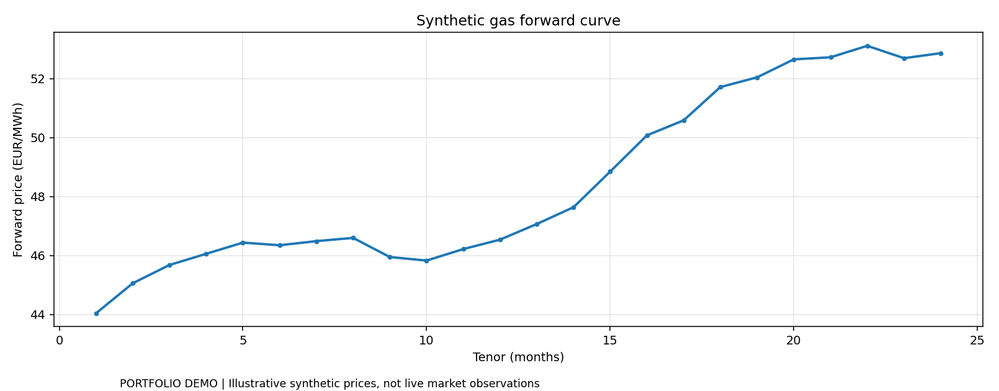

# Derivatives & Commodities Dashboard

**[▶ Launch the interactive Streamlit demo](https://derivatives-commodities-dashboard-w2nvxom4ud25bihfmm2hww.streamlit.app)** — try the dashboard in your browser, no Python installation needed.

**Explore:** [Python source](src/) · [Streamlit app code](app.py) · [Unit tests](tests/) · [Chart preview](assets/dashboard-preview.png) · [Run instructions](#run)

*The default example uses synthetic inputs; this is educational research, not live trading or an investment recommendation.*


**Options pricing, Monte Carlo simulation and commodities forward-curve analytics** in Python.



> Independent educational project, built as a market-facing Python portfolio example. It is **not** an IMC Trading product, IMC-endorsed app, or evidence of an IMC competition result. Every default market curve is **synthetic**; user-supplied CSV files can be analyzed locally.

## Features

- European call/put valuations under Black–Scholes with continuous dividend yield.
- Spot Greeks: delta, gamma, vega and theta (units explained in app).
- Option premium sensitivity surface by strike and implied volatility.
- Monte Carlo pricing for an arithmetic-average Asian call, with approximate 95% confidence interval.
- Energy forward term-structure classification (contango / backwardation).
- Interactive Streamlit dashboard and CSV export.

## Quick start

```bash
python -m venv .venv
# Windows: .venv\Scripts\activate
# macOS/Linux: source .venv/bin/activate
python -m pip install -e '.[dev]'
streamlit run app.py
```

CLI demonstration: `python examples/run_demo.py`  
Unit tests: `python -m pytest -q`

## Input data

Forward-curve uploads require the headers `tenor_months,forward_eur_mwh`, unique positive tenors, and strictly positive €/MWh prices. Example in `data/forward_curve_example.csv`.

## Financial assumptions and limitations

Black–Scholes assumes frictionless risk-neutral GBM, constant volatility/rates, and European exercise. The Monte Carlo Asian call is discretely monitored; its reported confidence interval reflects sampling uncertainty, not model risk. Forward-curve changes are descriptive and **do not** measure realizable calendar-spread P&L or rolling futures returns.

## Project status

Version 0.1: research/demo implementation with unit tests. Synthetic input data is explicitly labelled. No live trading or broker connectivity.

## CV context

See [`docs/CV_BULLETS.md`](docs/CV_BULLETS.md). Avoid claiming firm affiliation or competition wins.

License: MIT.

## Historical-data option

A new optional FRED spot-history reference panel displays **WTI crude spot** (`DCOILWTICO`, USD/bbl) or **US Henry Hub spot** (`DHHNGSP`, USD/MMBtu). These are genuine public historical **spot** observations — **NOT** TTF prices, not futures curves and not a roll-return backtest. The commodity term-structure chart remains synthetic unless a user supplies contract-specific historical/forward CSV. Source: [FRED data downloads](https://fred.stlouisfed.org/help/data/downloading/using-the-download-data-link).
